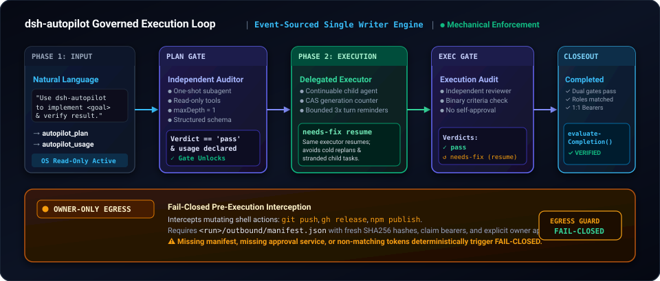

<p align="right"><b>English</b> · <a href="./README.zh-CN.md">简体中文</a></p>

# dsh-autopilot

A plan → execute → audit plugin for [DeepSeek Harness](https://github.com/deepseek-ai/deepseek-harness) (dsh). It ports the goal-autopilot harness (GAH) workflow into dsh plugin hooks: the agent plans first, an independent subagent audits the plan, a delegated executor does the work, a second audit checks the result, and the run only closes with evidence for every acceptance criterion.

[](https://www.npmjs.com/package/dsh-goal-autopilot)
[](https://github.com/My-Denia/dsh-autopilot-public/actions/workflows/ci.yml)
[](./LICENSE)

> [!NOTE]
> The npm package is **`dsh-goal-autopilot`**. The unscoped `dsh-autopilot` on npm is an unrelated package.

## Install

Requires dsh `0.2.0`, or the pre-release host `0.2.1-rc.2`, or `0.1.2-rc.1` / a `0.1.5` pre-release before `0.1.6`, and Node 22+. This source version is the pre-release `0.2.1-rc.1`. npm `latest` is still `0.2.0`.

**Desktop:** Settings → Plugins → Add plugin, enter `dsh-goal-autopilot@0.2.0`, then Install and Enable. `0.2.1-rc.1` is not on npm `latest`; install that pre-release from its tarball.

**CLI / headless / web:**

```sh
dsh plugin --profile <name> add dsh-goal-autopilot@0.2.0
```

## Usage

In a chat on that profile:

```text
Use dsh-autopilot to implement <goal> and verify the result.
```

To drive the `autopilot_*` tools by hand, see the [operator reference](./docs/reference.md).

## How it works

<p align="center"></p>

A run moves through `planning` → `plan-reviewing` → `executing` → `execution-reviewing` → `completed`. The first run in a session lives under `$DSH_HOME/storages/dsh-autopilot/runs/<sessionId>/`. A later goal in the same session gets its own run id; the finished run stays there.

- **Plan gate.** File writes and edits are blocked, and read-only sandbox mode is requested, until the plan audit passes. The plan states goal, scope, non-goals, risk, milestones and acceptance criteria, and declares observable usage states with `autopilot_usage`.
- **Independent audits.** Auditors are one-shot subagents with read-only tools and `maxDepth: 1`, returning `pass`, `needs-replan` or `blocked`.
- **Same-executor resume.** One continuable executor does the work; on `needs-fix` the same executor continues.
- **Next goal.** After `completed` or `blocked`, `autopilot_init` starts another run in the same session. It does not copy the previous run's gates, approvals, executor, or auditors.
- **Egress guard.** `git push`, `gh release` and `npm publish` are intercepted and need a valid evidence manifest (`<run>/outbound/manifest.json`) plus owner approval.
- **Evidence-bound closeout.** `completed` is refused until both gates pass and every acceptance criterion has an artifact on disk.
- **Turn reminder.** Up to three nudges if the agent stops mid-run.

Design details: [DESIGN.md](./DESIGN.md).

## Status

Developer preview. `0.2.1-rc.1` is a pre-release of this plugin for the pre-release host dsh `0.2.1-rc.2`.

| | |
| --- | --- |
| Tested on 0.2.1-rc.2, 2026-10-17 tarball | WSL2, local mock, no credentials: install without a version exemption; plan audit; delegated executor; needs-fix resume; closeout; a second goal in the same session; restart status stayed on that second goal. That package's client still treated one session as one run |
| Tested on 0.2.1-rc.2, tarball `b967e627…` | 2026-10-18, a different isolated home, local mock. sha256 `b967e62729f9b492415a9238c8f3a3f035f156bbd5d4014564cbd86c310f3e62`, packed from `567b7a7` (later doc commits are not in that file). Same lifecycle through a second goal; restart status stayed on that goal |
| Tested on 0.2.0-rc.2 | Install, mount, skill registration, plan audit, delegated executor and needs-fix resume on WSL2 with a local mock model |
| Client bundle | The `b967e627…` package's `lib/client.js` keeps an earlier run id in fold state (`priorRuns`) when a later init names a different run. The rendered card shows the live goal and does not list that earlier run. Bundle harness: 20 assertions on that file; those assertions do not cover `priorRuns`. A dsh `0.2.1-rc.2` web page on the same isolated home showed the card for the live goal. Desktop was not opened |
| Not yet tested | Full run with a real model. On 2026-10-18 headless sessions on dsh 0.2.1-rc.2 reached the configured model route and stopped with HTTP 503 before any autopilot tool ran. Desktop on macOS/Windows for this pre-release, and native Windows, were not opened |
| Host range | dsh 0.2.0 line, exact `0.2.1-rc.2`, `0.1.5` pre-releases before `0.1.6`, and exact `0.1.2-rc.1`. Other 0.2.1 prereleases and 0.1.7 are outside the range |
| Distribution | npm `latest` is `0.2.0`. GitHub Releases carry notes only |

See [docs/compatibility.md](./docs/compatibility.md) and [docs/security.md](./docs/security.md).

## Documentation

- [DESIGN.md](./DESIGN.md): architecture, GAH mapping, state machine
- [skill/dsh-autopilot/references/refusals.md](./skill/dsh-autopilot/references/refusals.md): what the engine refuses, and the remedy
- [skill/dsh-autopilot/references/model-routing.md](./skill/dsh-autopilot/references/model-routing.md): routing contract, ladder, work classes
- [skill/dsh-autopilot/references/governance-invariants.md](./skill/dsh-autopilot/references/governance-invariants.md): host-neutral governance rules
- [docs/compatibility.md](./docs/compatibility.md): dsh versions, Desktop notes, sandbox
- [docs/security.md](./docs/security.md): approvals, egress interception, sandbox
- [docs/reference.md](./docs/reference.md): `autopilot_*` tools, run state, usage classes
- [CHANGELOG.md](./CHANGELOG.md)

## Development

```sh
git clone https://github.com/My-Denia/dsh-autopilot-public.git
cd dsh-autopilot-public
pnpm install
npm run build
npm run check
npm test
dsh plugin --profile dev add .
```

## License

[MIT](./LICENSE) © 2026 My-Denia
